<!-- ═══════════════════════════════════════════ -->
<!--              ANIMATED HEADER BANNER         -->
<!-- ═══════════════════════════════════════════ -->

  

<!-- ═══════════════════════════════════════════ -->
<!--           TERMINAL TYPING ANIMATION         -->
<!-- ═══════════════════════════════════════════ -->

  

 

<!-- ═══════════════════════════════════════════ -->
<!--          SOCIAL BADGES (Custom SVG)         -->
<!-- ═══════════════════════════════════════════ -->

  
  &nbsp;
  
  &nbsp;
  
  &nbsp;
  

  

 

<!-- ═══════════════════════════════════════════ -->
<!--            TECH STACK SVG BANNER            -->
<!-- ═══════════════════════════════════════════ -->

  

 

<!-- ═══════════════════════════════════════════ -->
<!--            PROJECT CARDS (SVG)              -->
<!-- ═══════════════════════════════════════════ -->

  
  &nbsp;&nbsp;&nbsp;
  

 

<!-- ═══════════════════════════════════════════ -->
<!--           GITHUB STATS + LANGUAGES          -->
<!-- ═══════════════════════════════════════════ -->

  
  &nbsp;&nbsp;
  

 

<!-- ═══════════════════════════════════════════ -->
<!--           CONTRIBUTION STREAK               -->
<!-- ═══════════════════════════════════════════ -->

  

 

<!-- ═══════════════════════════════════════════ -->
<!--             LEETCODE STATS                  -->
<!-- ═══════════════════════════════════════════ -->

  

 

<!-- ═══════════════════════════════════════════ -->
<!--            GITHUB TROPHIES                  -->
<!-- ═══════════════════════════════════════════ -->

  

 

<!-- ═══════════════════════════════════════════ -->
<!--          CONTRIBUTION ACTIVITY GRAPH        -->
<!-- ═══════════════════════════════════════════ -->

  

 

<!-- ═══════════════════════════════════════════ -->
<!--              ANIMATED FOOTER                -->
<!-- ═══════════════════════════════════════════ -->

  

